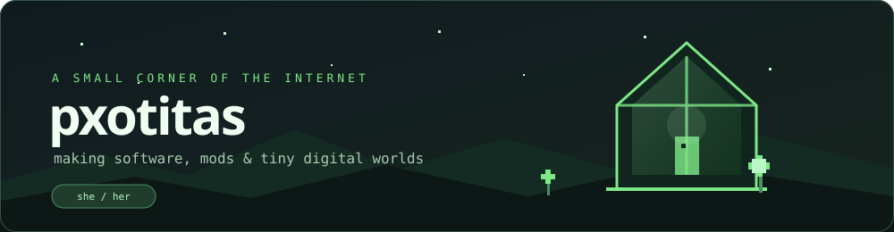

 

  

 

minecraft modder · software engineer · **coo, edonme studios**

---

`$ cat about.md`

hii :3 i'm chloe!! (px)

- creating mods, datapacks, and tools for minecraft at edonme studios.
- building software and side projects across different languages.
- professional yapper and nerd.
- currently making things for fabric — always tinkering with a new idea.
- C1 advanced english.

`$ cat system.md`

&nbsp;

  

`$ cat tools.md`

  

`$ cat stack.md`

 

&nbsp;

  

`$ cat focus.md`

**full stack development** · **game development** · **minecraft modding**

---

`$ cat stats.md`

  

`$ cat links.md`

| platform | link |
|:--:|:--:|
| website | [pxdritz1.github.io](https://pxdritz1.github.io) |
| modrinth | [modrinth.com/user/pxotitas](https://modrinth.com/user/pxotitas) |
| discord | [discord.gg/rX8jE45kgP](https://discord.gg/rX8jE45kgP) |

 

